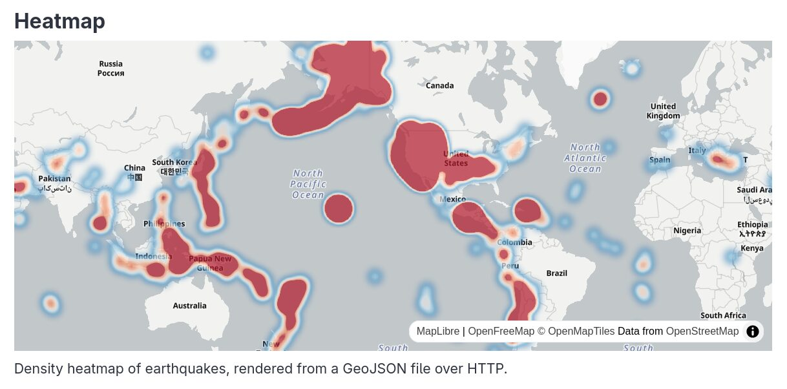

# Cartoj

[](https://github.com/perrygeo/cartoj/actions/workflows/test.yml)
[](https://clojars.org/io.github.perrygeo/cartoj)
---

---

**Cartoj** is a ClojureScript library for building interactive maps. The goal is to provide idiomatic [Reagent](https://reagent-project.github.io/) components which call into [react-map-gl](https://visgl.github.io/react-map-gl/) and the [MapLibre GL JS](https://maplibre.org/projects/gl-js/) engine.

```clojure
{io.github.perrygeo/cartoj {:mvn/version "0.4.0-alpha1"}}
```




## Status

**Beta** - API is almost stable but still actively tested/refined


## Documentation

* [API Docs](https://perrygeo.github.io/cartoj/)
* [Getting Started](./doc/01-getting-started.md)
* [Examples](https://perrygeo.github.io/cartoj/03-examples.html)
